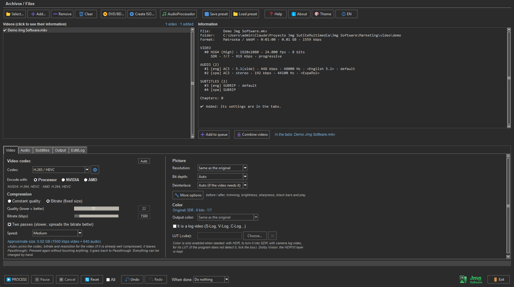
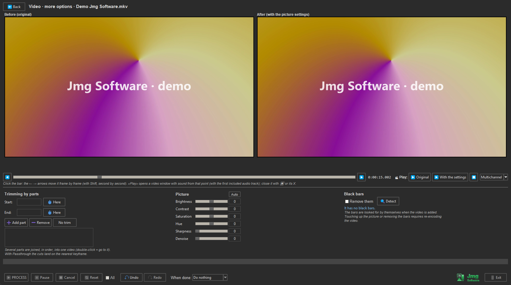
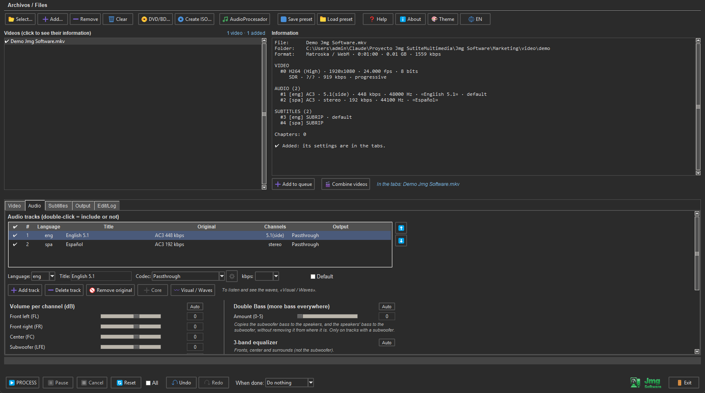
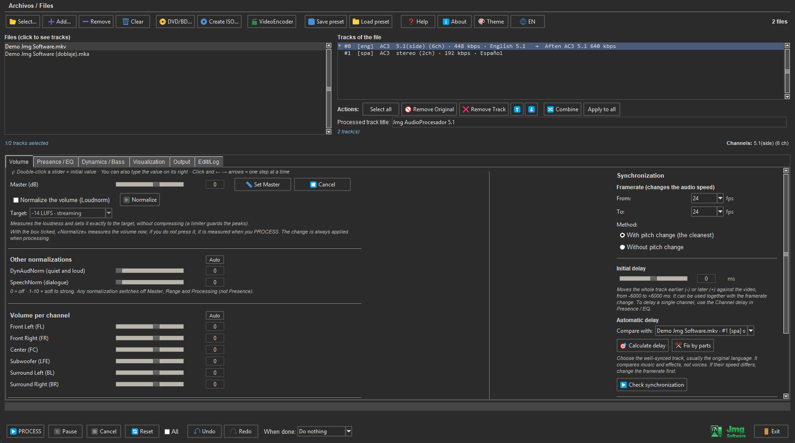
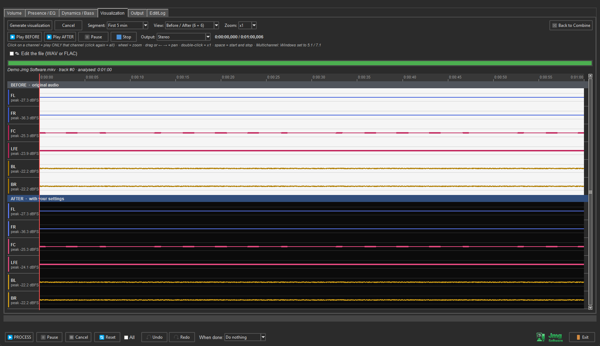
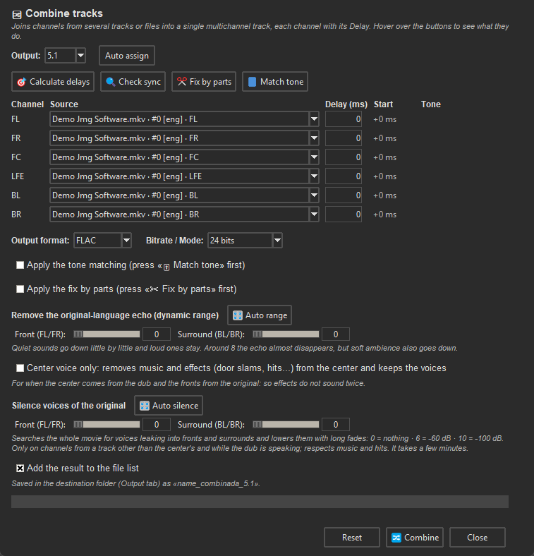

# Jmg SuiteMultimedia

**Español** · [English](#english)

Los dos programas de Jmg Software en una sola instalación, gratis y de código abierto, para mejorar el audio y el vídeo de tus películas y series. Usan FFmpeg y nunca tocan tus archivos originales.

- **Jmg VideoEncoder 1.5**: comprime y convierte vídeos (H.264, H.265, H.266 / VVC, AV1, VP9, ProRes y DNxHR, con el procesador o la tarjeta gráfica NVIDIA / AMD), con su audio, subtítulos, recorte por tramos, ajustes de imagen y sincronización. MKV, MP4, MOV, AVI y WebM.
- **Jmg AudioProcesador 5.1 (1.6)**: procesa, convierte y ajusta pistas de audio multicanal (5.1 / 7.1): volumen y normalización, presencia y ecualización, dinámica y graves, upmix de estéreo a 5.1 y «Combinar», que une canales de varias pistas para montar doblajes con su delay calculado solo.

## Vídeo tutorial

▶️ **[Ver el tutorial en YouTube](https://youtu.be/Qg61nox0Ox4)** (3 minutos, con subtítulos en 9 idiomas)

También doblado en: [Español](https://youtu.be/Qg61nox0Ox4) · [English](https://youtu.be/F5a_0C-4iZw) · [Français](https://youtu.be/wQW2m7Ejoco) · [Deutsch](https://youtu.be/gIqQqycyFZk) · [Português](https://youtu.be/fmZs9UNtxaI) · [Русский](https://youtu.be/j38NfoqlnSM) · [हिन्दी](https://youtu.be/h6ygC4n67YE) · [中文](https://youtu.be/h5cUSRnSc-g) · [日本語](https://youtu.be/51X65EwN1nw)

## Descarga

👉 **[Última versión](https://github.com/jmgsoftwaremultimedia/JmgSuiteMultimedia/releases/latest)**

| Archivo | Para |
|---|---|
| `JmgSuiteMultimedia_1.2_setup.exe` | Windows 10 / 11 (64 bits): instalador. Puedes elegir los dos programas (recomendado) o solo uno |
| `JmgSuiteMultimedia_1.2_portable.zip` | Windows sin instalar: descomprime y abre `Jmg SuiteMultimedia\Jmg SuiteMultimedia.exe` |
| `jmg-audioprocesador_1.6_all.deb` · `jmg-videoencoder_1.5_all.deb` | Linux (Debian, Ubuntu...): `sudo apt install ./jmg-videoencoder_1.5_all.deb` |

En Windows, FFmpeg va incluido (una sola vez para los dos programas): no hace falta instalar nada más. Los programas avisan cuando sale una versión nueva.

> Algunos antivirus desconfían de los programas nuevos sin firma digital. Si te avisa, es un falso positivo: el código fuente está aquí.

**¿Tenías Jmg AudioProcesador 7.0?** Ahora va dentro de esta suite, con una numeración nueva (1.6). El instalador ofrece quitar la versión anterior y tus ajustes se conservan.

## Qué hace

**Jmg VideoEncoder**
- Códecs de vídeo: H.264, H.265, H.266 / VVC, AV1 y VP9, y para editar ProRes 422 LT y DNxHR HQ. Calidad constante o bitrate, una o dos pasadas.
- Audio: cada pista en su formato (AC3 también con Aften, E-AC3, TrueHD, DTS, AAC, MP3, FLAC, Opus), con delay, framerate y corrección por tramos.
- Subtítulos, capítulos y portada; recorte por tramos con la imagen a la vista; ajustes de imagen (brillo, contraste, saturación, tono, nitidez, ruido) con «Auto».
- DVD y Blu-ray: ripear e imágenes ISO (copias sin protección o ya descifradas, si la ley de tu país te lo permite).
- Portada, título y año de la película con TMDB (con tu propia clave gratuita: el programa explica cómo conseguirla).

**Jmg AudioProcesador 5.1**
- Volumen y normalización, presencia y ecualización, dinámica y graves, con un botón **Auto** en cada ajuste que mide la película y coloca los controles por ti.
- Sincronización: cambio de framerate, delay automático y corrección por tramos.
- «Combinar»: une canales de varias pistas o archivos en una sola pista de hasta 7.1, con el delay de cada canal calculado solo.
- Visualización de los canales, escucha multicanal y un editor para bajar o subir el volumen de un trozo.
- Salida en Passthrough, AC3, EAC3, DTS, AAC, TrueHD, FLAC, WAV, RF64 y W64; de 1.0 a 5.1, upmix de estéreo a 5.1 y downmix.

Los dos: interfaz en español e inglés, ayuda completa en 9 idiomas, deshacer, presets y procesado por lotes. Los botones «🎵 AudioProcesador» y «🎬 VideoEncoder» pasan los archivos de un programa al otro.

## Capturas

| | |
|---|---|
|  |  |
|  |  |
|  |  |

## Construirlo desde el código

Cada programa es un solo archivo, `main.pyw` (Python 3 con tkinter). Para hacer los paquetes en Windows:

1. Instala Python 3 (con `pyinstaller` y `tkinterdnd2`) y [Inno Setup](https://jrsoftware.org/isinfo.php).
2. Copia `ffmpeg.exe`, `ffprobe.exe` y `ffplay.exe` de una compilación GPL de 64 bits de [BtbN](https://github.com/BtbN/FFmpeg-Builds/releases) en `Jmg AudioProcesador 5.1\bin`.
3. Ejecuta `Jmg SuiteMultimedia\construir_suite.bat`. El instalador, el portable y los .deb salen en `Jmg SuiteMultimedia\salida`.

## Licencia

Software libre bajo la licencia **GNU GPL v3** ([LICENSE](LICENSE)). Usa [FFmpeg](https://ffmpeg.org) (compilación de BtbN, GPL v3), [Aften](https://aften.sourceforge.net) (el codificador AC3, GNU LGPL 2.1) y un modelo de [rnnoise-models](https://github.com/GregorR/rnnoise-models). Los datos de las películas vienen de [TMDB](https://www.themoviedb.org); los programas usan su API, pero no están avalados ni certificados por TMDB. «Jmg AudioProcesador», «Jmg VideoEncoder», «Jmg SuiteMultimedia» y el logo Jmg Software son de su autor: las versiones modificadas deben usar otro nombre.

## Contacto y apoyo

- jmgsoftwaremultimedia@gmail.com
- Si te resulta útil, puedes apoyar el proyecto: [paypal.com/paypalme/JmgSoftware](https://www.paypal.com/paypalme/JmgSoftware)

Unos 45 días de trabajo, con pruebas en películas reales. Desarrollado por JMG (Jmg Software) con la ayuda de Claude, la inteligencia artificial de Anthropic.

---

## English

Jmg Software's two programs in a single installation, free and open source, to improve the audio and video of your movies and series. They use FFmpeg and never touch your original files.

- **Jmg VideoEncoder 1.5**: compresses and converts videos (H.264, H.265, H.266 / VVC, AV1, VP9, ProRes and DNxHR, on the processor or an NVIDIA / AMD graphics card), with their audio, subtitles, trimming by parts, picture adjustments and synchronization. MKV, MP4, MOV, AVI and WebM.
- **Jmg AudioProcesador 5.1 (1.6)**: processes, converts and adjusts multichannel audio tracks (5.1 / 7.1): volume and normalization, presence and EQ, dynamics and bass, stereo-to-5.1 upmix and «Combine», which joins channels from several tracks to build dubs with their delay calculated by itself.

▶️ **[Watch the tutorial on YouTube](https://youtu.be/F5a_0C-4iZw)** (3 minutes, in English) · Other languages: [Español](https://youtu.be/Qg61nox0Ox4) · [English](https://youtu.be/F5a_0C-4iZw) · [Français](https://youtu.be/wQW2m7Ejoco) · [Deutsch](https://youtu.be/gIqQqycyFZk) · [Português](https://youtu.be/fmZs9UNtxaI) · [Русский](https://youtu.be/j38NfoqlnSM) · [हिन्दी](https://youtu.be/h6ygC4n67YE) · [中文](https://youtu.be/h5cUSRnSc-g) · [日本語](https://youtu.be/51X65EwN1nw)

### Download

👉 **[Latest version](https://github.com/jmgsoftwaremultimedia/JmgSuiteMultimedia/releases/latest)**: `JmgSuiteMultimedia_1.2_setup.exe` (Windows installer: both programs or just one), `JmgSuiteMultimedia_1.2_portable.zip` (Windows, no install) or the `.deb` packages (Linux: `sudo apt install ./jmg-videoencoder_1.5_all.deb`). FFmpeg is included on Windows. The programs tell you when a new version is out.

> Some antivirus programs distrust new unsigned software. If yours complains, it is a false positive: the source code is here.

**Did you have Jmg AudioProcesador 7.0?** It is now part of this suite, with new version numbers (1.6). The installer offers to remove the old version and your settings are kept.

### Build from source

Each program is a single file, `main.pyw` (Python 3 with tkinter). Install Python 3 (with `pyinstaller` and `tkinterdnd2`) and Inno Setup, copy `ffmpeg.exe`, `ffprobe.exe` and `ffplay.exe` from a 64-bit GPL build by BtbN into `Jmg AudioProcesador 5.1\bin`, and run `Jmg SuiteMultimedia\construir_suite.bat`.

### License

Free software under the **GNU GPL v3** ([LICENSE](LICENSE)). Uses FFmpeg (BtbN build, GPL v3), Aften (AC3 encoder, GNU LGPL 2.1) and an rnnoise-models model. Movie data from TMDB; the programs use the TMDB API but are not endorsed or certified by TMDB. «Jmg AudioProcesador», «Jmg VideoEncoder», «Jmg SuiteMultimedia» and the Jmg Software logo belong to their author: modified versions must use another name.

Contact: jmgsoftwaremultimedia@gmail.com · Support: [paypal.com/paypalme/JmgSoftware](https://www.paypal.com/paypalme/JmgSoftware)

About 45 days of work, with tests on real movies. Developed by JMG (Jmg Software) with the help of Claude, Anthropic's AI.
